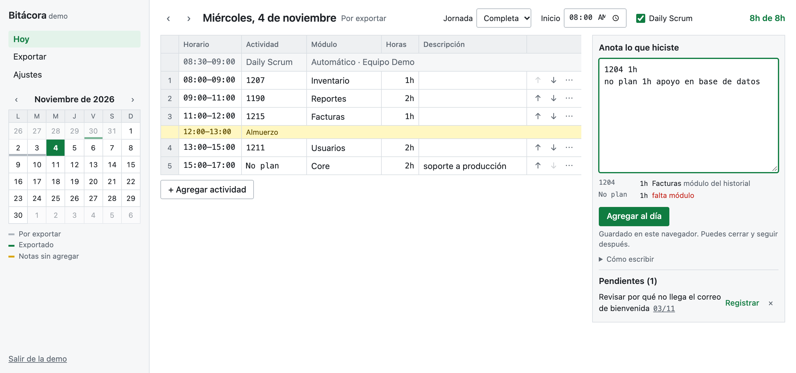
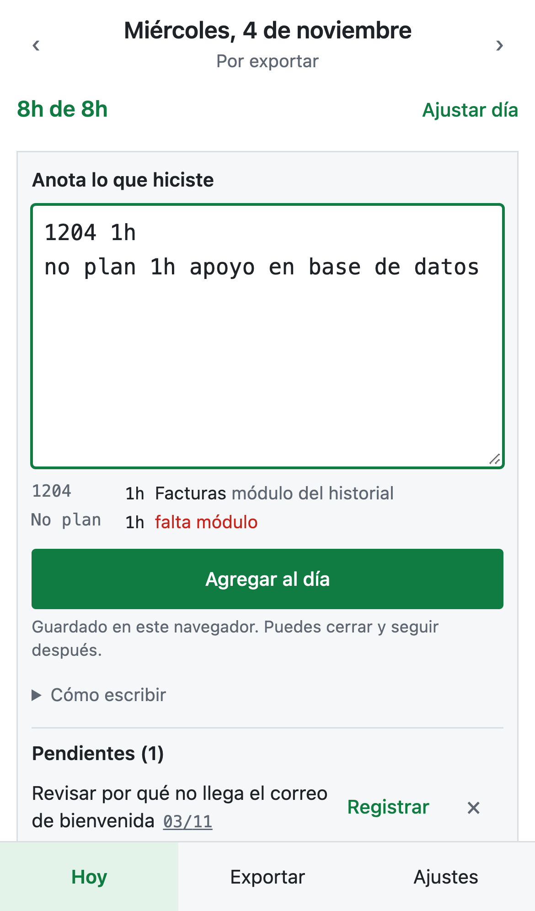

# Bitácora

Convierte notas rápidas de trabajo en el CSV de horas que acepta el sistema de registro, sin pasar
por Excel.



## El problema

Registrar horas tomaba tres pasos manuales: anotar en un papel, pasar todo a Excel y convertirlo al
CSV que importa el sistema. Un análisis de 782 filas reales mostró que casi todo ese trabajo se
puede calcular:

| Hallazgo en los datos                                           | Decisión en la app                         |
| --------------------------------------------------------------- | ------------------------------------------ |
| Una regla simple reproduce el horario en 92 % de días recientes | Las horas se calculan solas                |
| El Daily aparece en todos los días laborales                    | Se agrega automáticamente                  |
| Seis columnas del CSV nunca se usan                             | Se exportan vacías, sin pedirlas           |
| 46 % de los tickets se repiten en varios días                   | El módulo se completa desde el historial   |
| 37 formas de escribir los módulos y 4 de escribir No Plan       | Corrección de errores y catálogo unificado |

## Cómo funciona

Pensada primero para el teléfono, con una vista de hoja de cálculo en pantallas grandes.



```text
1204 1h
1207 2h planilla
no plan 2h core apoyo a producción
apoyo revisar correo que no llega
```

1. Escribes una línea por actividad a lo largo del día. Cada tecla queda guardada, así que puedes
   cerrar el navegador y seguir después. Lo que no tiene horas queda como pendiente.
2. También puedes usar **Agregar actividad** y llenar ticket, tiempo, módulo y descripción.
3. La app agrega el Daily, completa módulos y calcula horarios y almuerzo. Las actividades se
   reordenan con las flechas y los horarios se recalculan solos.
4. Revisas el día. Avisa si no suma 8 h y bloquea los errores que dañarían el archivo.
5. Descargas o compartes el CSV. Los días quedan marcados para no importarlos dos veces.

## Tecnología

- **Interfaz:** React 19, TypeScript estricto, Vite y PWA instalable.
- **Datos:** Supabase (PostgreSQL) con capa propia local-first: funciona sin conexión y sincroniza
  al volver la señal.
- **Acceso:** código por correo o Google, con Row Level Security y lista de cuentas autorizadas.
- **Calidad:** Vitest, Testing Library, Playwright en Chromium y WebKit, pruebas de seguridad sobre
  PostgreSQL real con PGlite, ESLint y GitHub Actions.
- **Despliegue:** Vercel.

La lógica de negocio vive en [`src/domain`](src/domain), sin dependencias de React ni Supabase. Las
decisiones están en [docs/arquitectura.md](docs/arquitectura.md).

## Desarrollo local

```bash
npm install
npm run dev
```

Sin configurar Supabase, la app funciona en modo demo con datos ficticios en tu navegador.

| Comando            | Qué hace                                |
| ------------------ | --------------------------------------- |
| `npm run check`    | Formato, lint, tipos, pruebas y build   |
| `npm run test:e2e` | Pruebas en navegador con Playwright     |
| `npm run test:db`  | Seguridad de la base en PostgreSQL real |

Para publicarla, sigue [docs/despliegue.md](docs/despliegue.md).

## Privacidad

El repositorio es público, los datos no. Solo las cuentas autorizadas leen o escriben, y las pruebas
usan datos inventados. Las notas privadas nunca se incluyen en el CSV.
